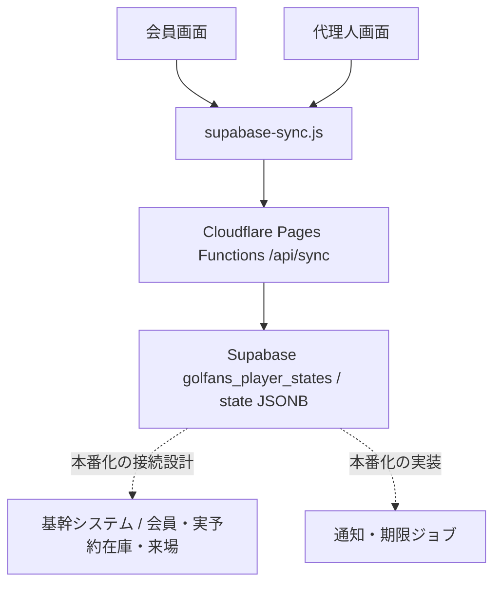
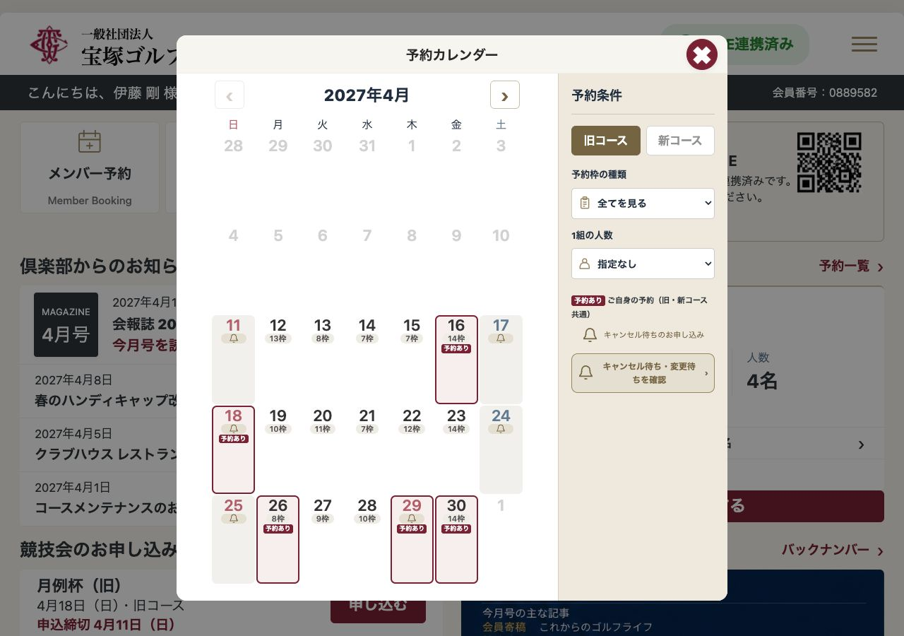
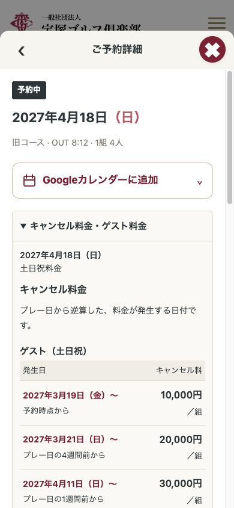
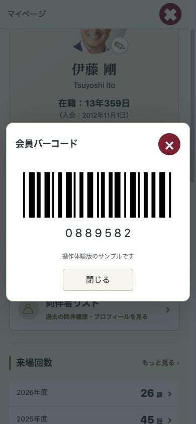

# 宝塚GC 会員専用ポータル — 開発引継ぎ・本番化計画 v2.1

2026-11-02 / オサケンさん承認・伊藤さんSlack送付版

[資料一覧・伊藤さん共有原資料](README.md) / [承認済みPDF](宝塚GC_開発引継ぎ・本番化計画_Yep松林様_20261102_v2.1.pdf)

このMarkdownは承認済みPDFから同じ内容を参照できるよう整えたものです。役割分担・本番方式の協議状況は本文に従います。

## 01. 会員体験を、
運用できるサービスへ

宝塚ゴルフ倶楽部 会員専用ポータル｜開発引継ぎ・本番化計画

株式会社yep 松林様向け
2026年11月2日 / v2.1 / 協議用改訂案

> **今回の引継ぎの目的**
> 伊藤剛氏が具体化した会員・代理人の利用体験と、既存の保存・公開・更新基盤を開発資産として共有し、本番化の実装範囲・責任分担・受入条件を合意する。

### 現在地

現状は、Supabaseへの保存・読込を備えた動作プロトタイプである。会員の操作を具体的に確認できる一方、実予約在庫との接続、本人確認・代理権限、同時更新、実通知は本番化の設計・検証対象として残る。

### 開発会社と最初に合意すること

| 論点 | 今回決めたいこと |
| --- | --- |
| 01 活用範囲 | 既存UI・操作ロジック・保存API・更新基盤のうち、引き継ぐ部分と再構成する部分。 |
| 02 データと責任 | 基幹システムとSupabaseの正本、認証・予約制御・通知の担当、障害時の復旧責任。 |
| 03 双方AIからの継続改修 | 伊藤氏のChatGPTと長田氏側AIが、共通の最新コードへアクセスし、指示時に修正・プレビュー・検査・反映確認できる仕組みを本番要件に含める。 |

企画・体験設計：伊藤 剛
メンター・コーチ：長田 賢一郎
技術整理・編集：長田 賢一郎 内 Codex（AIパートナー）

原資料の基準：main / ab9d024bb367（2026-11-02 10:56 JST）。本改訂の根拠と確認範囲はp14。

## 02. 現在の構成と、本番化の接続点

実線：既存実装・記録で確認した経路　／　破線：本番化に向けて定義する経路

> **保存と予約確定の責任を分ける**
> 現在のAPIは、画面の状態を保存・復元する仕組みである。本番では、会員の権限・空き枠・受付条件をサーバーで照合したうえで、予約の確定結果を返す構成を定義する。

公開・コード更新：ChatGPT側の体験版 → GitHub Actionsによる取得・検証 → GitHub → Cloudflare Pages。手動更新画面とOAuth対応MCPコネクタから、同じ更新処理を起動する構成がある。詳細はp11。

## 03. 引き継ぐ資産と、本番化の範囲

「存在する実装」「過去の検証記録」「今回合意する設計」を分けて扱う。

| 領域 | 既存資産・確認した内容 | 本番化で必要なこと |
| --- | --- | --- |
| 会員・代理UI | 予約・複数組・同伴者・変更取消・公開設定等の動作プロトタイプ。 | 操作意図を維持し、API・権限制御へ接続する。 |
| DB保存 | /api/sync経由でgolfans_player_statesへstateを保存・取得。 | 認証、データ責任、競合検知、失敗時の復旧を定義する。 |
| 予約在庫 | サンプル枠とブラウザ側ロジックで体験を構成。 | 基幹照会、排他制御、複数組の確保、変更取消の整合性。 |
| 代理予約 | 招待・停止・解除・会員切替等の体験。委任情報はローカル。 | 本人確認、委任トークン、失効、サーバーでのアクセス判定。 |
| キャンセル待ち | ブラウザ内デモ。待ち列・仮確保・回答期限の体験。 | 共通待ち列、枠の一意な仮確保、期限ジョブ、実通知。 |
| 共有・カレンダー | Google予定作成リンク、メール・LINE等への共有導線。 | 自動通知、予約変更・取消の自動反映の要否と方式。 |
| 公開・更新基盤 | 自動同期、公開内容のハッシュ照合、手動更新・MCP経路。 | 本番コードの所有、同期対象、検証環境、リリース責任。 |

### 支援側で整えてきたもの

利用体験の具体化を支えながら、DB保存、GitHubでのコード管理、Cloudflareへの配信、自動・手動の反映経路を整備した。開発会社への引継ぎでは、この基盤の利用可否と本番品質への移行方針を確認する。

実装の存在だけで、本番業務への適合や全画面の検証済みを意味するものではない。機能別の受入確認はp13。

## 04. 予約の状況と、次の操作を見失わない

画面例：2026-11-01取得 / 1280×900 / 配信照合時コミット85169b3。サンプルデータの表示。

| 守る体験 | 実装・受入の観点 |
| --- | --- |
| 予約がある日を識別 | 本人の予約と一般の空き状況を区別し、詳細・一覧へ進める。 |
| 選択状態を保持 | 条件や選択内容を見失わず、複数枠を選択できる。4組以上では選択リスト内を追従させる。 |
| 元の場所へ戻る | 詳細や変更・取消から戻る際、対象日・対象予約の位置へ復帰する。 |
| PCとスマホの整合 | レイアウトが変わっても、表示内容・確定の意味・結果は一致させる。 |

関連コード：index.html / booking-desktop.js・css / reservation-calendar.js・css。図は前日時点の例で、原資料基準コミットと同版の画面保証ではない。

## 05. 重要な日付と、操作の意味を明確にする

画面例：2026-11-01取得 / 390×844。表示データ・会員バーコードは試作用。

| 画面 | 引き継ぐ意図と本番での対応 |
| --- | --- |
| 料金・取消条件 | 「何日前」だけでなく予約ごとの実日付を示す。料金の正式原本・適用版との照合、サーバー側の同意保存を行う。 |
| 会員証・チェックイン | 本人が提示しやすい拡大・閉じる操作を保つ。本番は発券・読取・本人認証と接続する。 |
| 共通操作 | 大きな閉じるボタン、明確な確定操作、本文を読み進めやすいスクロール、戻り位置を受入条件にする。 |

画像の寸法をそのまま実装仕様にせず、対象端末で日付・時刻・人数・主操作の視認性を確認する。

## 06. 予約から変更・取消までの体験仕様

フロントの挙動を、サーバーで保証すべき業務結果へ対応させる。

| 操作 | 保持する仕様 | サーバー側の確定条件 |
| --- | --- | --- |
| 予約 | 日付・コース → 枠と人数 → 料金確認・手動同意 → 確定 → 同伴者登録／後で登録 → 一覧。 | 受付条件、本人・代理の合算上限、空き枠を確認し、予約IDと確定結果を返す。 |
| 複数組 | 各組のidと全体のbatchIdを区別。予約件数と組数を混同しない。本人参加枠と紹介枠を識別。 | 全組をまとめて確保する方式、失敗時に残す／戻す単位を定義する。 |
| 同伴者 | 未選択・未定・実名を区別。同組・別組の重複を確認し、残る組へ進む。 | 氏名だけでなく会員ID等で同姓同名を区別。登録結果を再照会できる。 |
| 時間変更 | 対象日の枠へ進み、現在の枠を示す。変更が確定するまで元予約を維持。 | 新枠の確保と元枠の解放の整合性、競合・途中失敗の復旧を保証する。 |
| 一部／全取消 | 対象組と残る組数を明示し、確認後に取消。途中で予約内容が変われば再確認。 | 適用規定、取消対象、実行者、処理時刻を保存。再実行による重複取消を防ぐ。 |
| イベント | 受付前・受付中・満員・対象外・申込済を区別。同日プレー予約があれば確認。 | requested（受付待ち）と確定を区別し、実受付・定員・対象資格へ接続する。 |

> **本番の完了表示**
> 画面内の状態変更だけで「予約確定」とせず、サーバー側で確定した結果と一致したときに完了を表示する。処理中・失敗・結果不明を区別する。

関連：booking*.js / proxy-multiple.js / member-details.js / guest-undecided.js / reservation-*.js。

## 07. 料金・代理権限・公開範囲の確認事項

以下の金額・条件は原資料のコード転記。正式な倶楽部規定との照合・承認を実装前に行う。

| 対象 | 原資料にある仕様 | 確定・実装する点 |
| --- | --- | --- |
| 取消料：ゲスト | 平日：2週間前から10,000円／組。土日祝：予約時5,000円 → 6週間前10,000円 → 4週間前20,000円 → 1週間前30,000円。加算しない。 | 規定原本、有効期間、予約変更時の再同意、組数減少・免除の判定。 |
| 取消料：メンバー | 全日：1週間前から2,000円／人。倶楽部競技・準倶楽部競技の注記あり。 | 競技・プラン等の例外と適用区分。 |
| ゲスト料金 | 平日29,850円／人、土日祝32,050円／人。税込・利用税1,200円・振興基金50円を含む表示。 | 対象年度・プラン・税等の条件と正式料金の一致。 |
| 同意 | 自分でチェックするまで確定不可。feeConsentに規定版・同意時刻・対象日を記録する処理。 | 表示した内容と確定対象の一致をサーバーで保存・検証。 |
| 代理人 | 会員あたり最大2名の体験。招待中・停止中も上限に含む。招待期限7日。実メールは未送信。 | 正式上限、招待の本人確認・期限・失効、本人＋代理の予約合算、操作履歴。 |
| 写真・情報公開 | ミニマム／ミドル／フル／カスタム。本人用写真と他会員への公開を分離。代理画面は写真非表示等。 | 会員区分・JGA Index等を含む公開DTO、画像保管先、閲覧権限を確定。 |

本人を置く組（選択順／時刻順）、代理人の履歴閲覧範囲、季節別上限・受付開始日も未確定。UIの表示値を正式ルールとして採用せず、倶楽部決定版と対応付ける。

### 原資料にある表示基準

| 項目 | 引き継ぐ基準 |
| --- | --- |
| 共通色 | 背景 #f7f5ef、文字 #2d3538、主要操作のえんじ #7b2033。面は白を基本とする。 |
| 強調と同意 | 取消料の発生日は18〜20px・太字・えんじ。チェック欄28px角・枠線4px。未選択時は印を出さない。 |
| 端末幅 | 予約PCレイアウトの主な切替は1000px、ホームに850px基準もある。タブレットを含め採用構成で再確認する。 |

## 08. 現在の保存構造と、移行設計

現在は、会員キーごとに画面状態をJSONBで保存する構造。本番データモデルは協議して定義する。

| 要素 | 既存実装・記録で確認した構造 |
| --- | --- |
| 保存先 | golfans_player_states |
| 識別・属性 | player_key（TKZ_＋会員識別子）、member_id、name |
| 保存本体 | state（JSONB）、created_at / updated_at（記録上のタイムスタンプ） |
| stateの主要項目 | reservations / reservationHistory / companions / line / events / eventApplications / profileContent / profileVisibility |
| 現在の送信対象外 | 本人写真profilePhoto、委任情報、waitlistDemo。 |
| 同期の非対称性 | 本人は主要項目を取得。代理側の取得反映は主に予約・履歴。代理側のクラウド保存はito担当時に限定。 |

### 本番設計で決める単位

| データ | 設計上の確認点 |
| --- | --- |
| 会員・代理人・委任 | 本人ID、担当会員ID、権限、招待・停止・失効を分ける。 |
| 予約・組・参加者 | 正式予約ID、枠ID、状態、版、操作者、同意記録を対応付ける。 |
| 空き枠・待ち列 | 枠の正本、仮確保、期限、優先順、承諾処理をサーバーで扱う。 |
| 通知・監査 | 送信先、送信結果、再送、変更履歴と障害復旧を追跡できる形にする。 |

テーブルの物理分割や既存JSONBの継続利用は未決。基幹APIと業務責任を確定したうえで、制約・マイグレーション・移行手順を含むDDLを作成する。

## 09. 現行の保存・取得API

ローカル実装の読取に基づく現状整理。新しい本番API仕様として確定したものではない。

| 操作 | 入力 | 成功応答・処理 |
| --- | --- | --- |
| GET /api/sync | query：member_id（コード上は未指定時の固定値あり）。 | 会員キーで読込。ok / found / member_id / player_key / storage / state。取得済みの場合updated_at。未登録はfound=false・state=null。 |
| POST /api/sync | JSON：member_id / member_name / state。 | 会員キーでstate全体をupsert。ok=true / saved=true / member_id / player_key / storage / updated_at。 |
| OPTIONS | CORS preflight。 | 204。現コードはAccess-Control-Allow-Origin: *。 |
| エラー | JSON不正、DB応答異常、通信例外等。 | JSON不正400、設定不足500、DB由来のHTTP状態、通信例外502等を返す処理。 |

### 本番契約で補う事項

| 論点 | 要求する仕様 |
| --- | --- |
| 認証と会員の特定 | クライアントのmember_idを信用せず、認証済み本人と有効な委任関係からアクセス対象を判定。 |
| 同時更新 | 版番号等で競合を検知。全state上書きによる更新消失を防ぐ。 |
| 再送と結果確認 | 変更系の冪等キー、結果照会、タイムアウト後の扱いを定義。 |
| エラーと監査 | 業務エラー・権限不足・競合・処理中を区別。request_idと実行者を追跡。 |

原資料とローカルコードには、API内での呼出元認証・委任検証が見当たらない。外部保護・配備設定・実RLS・使用キーは別途確認する。秘密値はこの資料に記載しない。

参照：functions/api/sync.js、supabase-sync.js。原資料p10との整合を確認し、本番設計時は採用コミットで再固定する。

## 10. 予約・待ち列・通知を成立させる条件

以下は本番設計への提案。倶楽部・開発会社・支援側の合意で確定する。

| 場面 | サーバーで保証すること |
| --- | --- |
| 新規・複数組予約 | 本人／代理の権限と上限、受付条件、空き枠を検証。同じ枠の二重確定を防ぐ。複数組の確保単位と失敗時の扱いを明文化。 |
| 時間変更 | 元予約を照会し、変更対象と版を確認。新枠の確保・元枠の解放を整合させ、途中失敗時に結果を確定できる。 |
| 取消 | 対象組・料金規定・権限を照合。多重実行、基幹との片側成功、通信断後の結果不明を処理する。 |
| キャンセル待ち | 全会員共通の待ち列、適合条件、優先順、仮確保の一意性、回答期限と次の人への移行を管理。 |
| 変更待ちの承諾 | 確定まで元予約を維持。元予約の変更取消で待ちを無効化し、承諾時に新旧の枠を整合させる。 |
| 通知 | メール／LINEの実通知は別実装。未達・重複・再送、送信履歴、停止条件を管理する。 |
| Googleカレンダー | 現状は予定作成リンク。自動登録・変更・取消連動を求める場合、同意・権限・更新先・失敗時の扱いを追加設計する。 |

> **待ち列の暫定値は、正式ルールへ置き換える**
> 原コードの通知10〜17時、回答1時間、前日18時受付期限、変更待ち優先は体験用の値。公平性と倶楽部運用を確認してから採用する。

現行waitlist-engine.jsはブラウザ内デモ。waitlistDemoは現在の同期payloadに含まれない。実予約や実通知が開通済みとは扱わない。

## 11. 双方のAIから、随時アクセス・修正する

本番化の必須要件：伊藤氏のChatGPTと長田氏側AIが、開発会社と同じ正本を起点に継続改修できること。

> **目指す運用**
> それぞれのAIへ指示 → 最新コード・仕様を取得 → 修正 → プレビューで確認 → 自動検査 → 合意済みの手順で反映 → 結果確認。開発会社への都度の作業依頼や、コードの手渡しを前提にしない。

### 開発会社へ求める接続・改修機能

| 要件 | 実装・受入で確認すること |
| --- | --- |
| 共通の最新情報へアクセス | 伊藤氏のChatGPTと長田氏側AIの双方から、最新コード、API仕様、DBスキーマ、変更履歴へ必要な範囲でアクセスできる。画面・業務ロジック・API等、合意した改修範囲を扱える。 |
| AIから修正を実行 | MCP・API・GitHub連携等で、コード取得、差分作成、検査起動、結果取得を接続。開発会社が運用可能な方式を提示する。秘密値をAI対話や公開クライアントへ転記しない。 |
| 指示した時に確認できる | 定期同期の時刻を待たず、任意のタイミングで修正とプレビュー更新を起動。双方が同じ変更結果を確認できる。所要時間の目標値は協議で定める。 |
| 変更を失わず統合する | 伊藤氏側・長田氏側・開発会社の変更を履歴に残し、同時変更の衝突を検知。一方向同期による上書きを防ぎ、本番コードの正本へ統合する。 |
| 反映の成否まで確認 | アプリ・DBの検証／本番を区別。自動検査、処理状況、配信結果、失敗時の復旧を確認できる。受付を反映完了とせず、変更単位で結果を追跡する。 |

**既存基盤との関係：**手動更新画面とOAuth対応MCPコネクタは、既存workflowの更新起動・状況照会を担う。双方のAIによるコード読取・編集・検査までの一連の接続は、追加設計・実装・受入の対象。現行の2時間おき同期だけでは、この要件を満たさない。

「リアルタイム」は、指示時に処理を開始し、プレビューと反映状況を随時確認できる運用を指す。同時キー入力の共同編集や所要時間ゼロを意味しない。

## 12. 担当範囲を合意して、実装へ進む

下表は協議用の役割案。各社の契約範囲・実装責任を確定するものではない。

| 成果物・判断 | 主担当の提案 | 協議する相手 |
| --- | --- | --- |
| 利用者体験・優先順位 | 伊藤氏：会員・代理人の体験、業務価値、変更の優先順位を提示。 | 長田氏、yep、倶楽部 |
| 技術支援と継続改修 | 長田氏＋AI：構想と実装の整理、既存基盤の引継ぎ、双方AIからの継続改修を支援。 | 伊藤氏、yep |
| 本番アプリとAI接続 | yep：採用構成、API、認証、業務制御に加え、p11の双方AI接続・修正・検証・反映経路を設計。 | 倶楽部、基幹ベンダー、支援側 |
| 基幹API・データ正本 | 倶楽部・基幹ベンダー・yepで、照会／更新／同期／復旧の責任を決定。 | 伊藤氏、長田氏 |
| 正式規定・公開方針 | 倶楽部：受付条件、料金、代理・情報公開、待ち列の運用を決定。 | 伊藤氏、yep |
| 受入とリリース | 機能・業務・権限・運用の確認者、公開判断者、障害対応者を指名。 | 全関係者 |

### 開発会社から提示いただきたいもの

採用構成図、既存資産の利用／再構成一覧、API契約、DB設計・移行方針、双方AIの接続・修正・プレビュー・反映方式、検証環境、実装・受入・公開までの工程を提示いただく。

### 初回協議の成果物

> 「誰が・何を・どの条件まで実装するか」を記入した範囲表と、未確定事項の担当・回答期限を残す。その合意をもとに見積り・工程・受入条件を具体化する。

## 13. 受入確認と、優先して解く課題

ブラウザ内の成功と、DB・基幹・通知まで成立した成功を分けて検証する。

| 区分 | 確認シナリオ・期待結果 |
| --- | --- |
| 双方AIからの改修 | 伊藤氏のChatGPTと長田氏側AIから、それぞれ最新コードを取得し、テスト用変更・プレビュー・検査・反映結果確認まで完了。相手の変更を失わず統合できる。 |
| 共有状態：最優先 | 同一のテスト会員・予約を、再読込・別ブラウザ・別端末で照合。共有すべき状態が一致し、試作・接続先の違いを識別できる。 |
| 予約・同伴者 | 本人／代理、1組／複数組、逆順選択、紹介枠、未定・実名・重複・後で登録。件数・組数・本人参加が一致。 |
| 料金・同意 | 平日・土日祝・直前予約。実日付と単位、同意前無効、チェック解除、内容変更後の再確認。 |
| 変更・取消・競合 | 一部／全取消、本人と代理の同時編集、同一空き枠への競合、通信断・再送、基幹との片側失敗。結果と元予約の扱いが確定できる。 |
| 代理・公開 | 有効な委任範囲だけ操作可能。停止後は操作不可。写真・他会員情報の公開方針がAPIにも反映される。 |
| 待ち・通知 | 元予約の変更、期限切れ、通知未達、承諾二重実行。枠・待ち順位・送信履歴が整合。 |
| 端末・リリース | スマホSafari、PC、タブレット、LINE内ブラウザ。主操作の視認性、戻り位置、公開反映確認、前版復旧。 |

> **現在報告されている不一致**
> 11/2の通話で、伊藤氏側・共有URL側・GitHub由来の動作版で予約件数が異なるとの申告がある。原因は未特定。版、接続先、固定会員、初期サンプル、ローカル状態、DB保存・取得を切り分けて確認する。

検証実績の範囲：原資料は既存公開API／クライアント15件と料金関数4例を実行したと記載。全画面実機、実Supabase疎通・書込、基幹連携、予約負荷・同時実行は同資料で未実施。これらを本番予約の合格実績に置き換えない。

## 14. 根拠・コード索引・改訂管理

本改訂は、利用体験・既存基盤・本番化の協議事項をつなぐために再構成した。

| 根拠 | 利用した内容と確認範囲 |
| --- | --- |
| A 原引継ぎPDF | 宝塚GC_GitHub実装引継ぎ資料_Yep松林様_20261102.pdf、v1.0、全13ページ。基準main / ab9d024bb367。今回の機能・仕様・未確定事項の起点。 |
| B ローカル実装 | golfans_members-connectのsync API、同期JS、workflowを読取。作業ツリーに他者差分があり、原資料と同一版とは扱わない。採用時にコミットを固定して再確認。 |
| C 画面・配信証跡 | 2026-11-01_ito-ui-sync/verification.jsonと原画像3点。取得2026-11-01、source_commit 85169b3。今回の画像はその時点の参照例。 |
| D 支援・検証記録 | 10/27の専用DB構築決定記録、11/1の手動反映・MCP公開検証記録、connector/OPERATIONS.txtを照合。現在値の再検証とは区別。 |
| E 利用者の申告 | 11/2 LINE電話議事録。UI引継ぎ、環境別の予約件数不一致、テスト／本番、継続改修の論点に利用。 |

### 主要コードの入口

- 画面：[index.html](https://github.com/osAKen-ai/golfans_members-connect/blob/ab9d024bb367/index.html) / [proxy.html](https://github.com/osAKen-ai/golfans_members-connect/blob/ab9d024bb367/proxy.html) / [club-theme.css](https://github.com/osAKen-ai/golfans_members-connect/blob/ab9d024bb367/club-theme.css)
- 予約：[booking-multiple.js](https://github.com/osAKen-ai/golfans_members-connect/blob/ab9d024bb367/booking-multiple.js) / [proxy-multiple.js](https://github.com/osAKen-ai/golfans_members-connect/blob/ab9d024bb367/proxy-multiple.js) / [guest-undecided.js](https://github.com/osAKen-ai/golfans_members-connect/blob/ab9d024bb367/guest-undecided.js)
- 料金・取消：[reservation-fees.js](https://github.com/osAKen-ai/golfans_members-connect/blob/ab9d024bb367/reservation-fees.js) / [reservation-cancellation.js](https://github.com/osAKen-ai/golfans_members-connect/blob/ab9d024bb367/reservation-cancellation.js)
- 代理・公開：[delegation-data.js](https://github.com/osAKen-ai/golfans_members-connect/blob/ab9d024bb367/delegation-data.js) / [proxy-member-parity.js](https://github.com/osAKen-ai/golfans_members-connect/blob/ab9d024bb367/proxy-member-parity.js) / [events-profile.js](https://github.com/osAKen-ai/golfans_members-connect/blob/ab9d024bb367/events-profile.js)
- データ・待ち：[supabase-sync.js](https://github.com/osAKen-ai/golfans_members-connect/blob/ab9d024bb367/supabase-sync.js) / [functions/api/sync.js](https://github.com/osAKen-ai/golfans_members-connect/blob/ab9d024bb367/functions/api/sync.js) / [waitlist-engine.js](https://github.com/osAKen-ai/golfans_members-connect/blob/ab9d024bb367/waitlist-engine.js)
- 更新：[.github/workflows/auto-sync-ito.yml](https://github.com/osAKen-ai/golfans_members-connect/blob/ab9d024bb367/.github/workflows/auto-sync-ito.yml) / [functions/api/publish.js](https://github.com/osAKen-ai/golfans_members-connect/blob/ab9d024bb367/functions/api/publish.js) / [connector/OPERATIONS.txt](https://github.com/osAKen-ai/golfans_members-connect/blob/ab9d024bb367/connector/OPERATIONS.txt)

### 参照先・版の扱い

[GitHub：osAKen-ai/golfans_members-connect](https://github.com/osAKen-ai/golfans_members-connect)
[公開体験版：takarazuka.golfans.com](https://takarazuka.golfans.com/)

本改訂作成時、公開URLのHTTP取得は403となり、現時点の配信・実DB疎通は再確認できていない。クラウド設定・実データ・コードは変更していない。

v2.1：双方AIからの随時アクセス・修正・プレビュー・反映確認を必須要件として明文化し、担当範囲と受入条件へ反映。方式・費用・所要時間等は協議で確定。責任分担は協議案。
